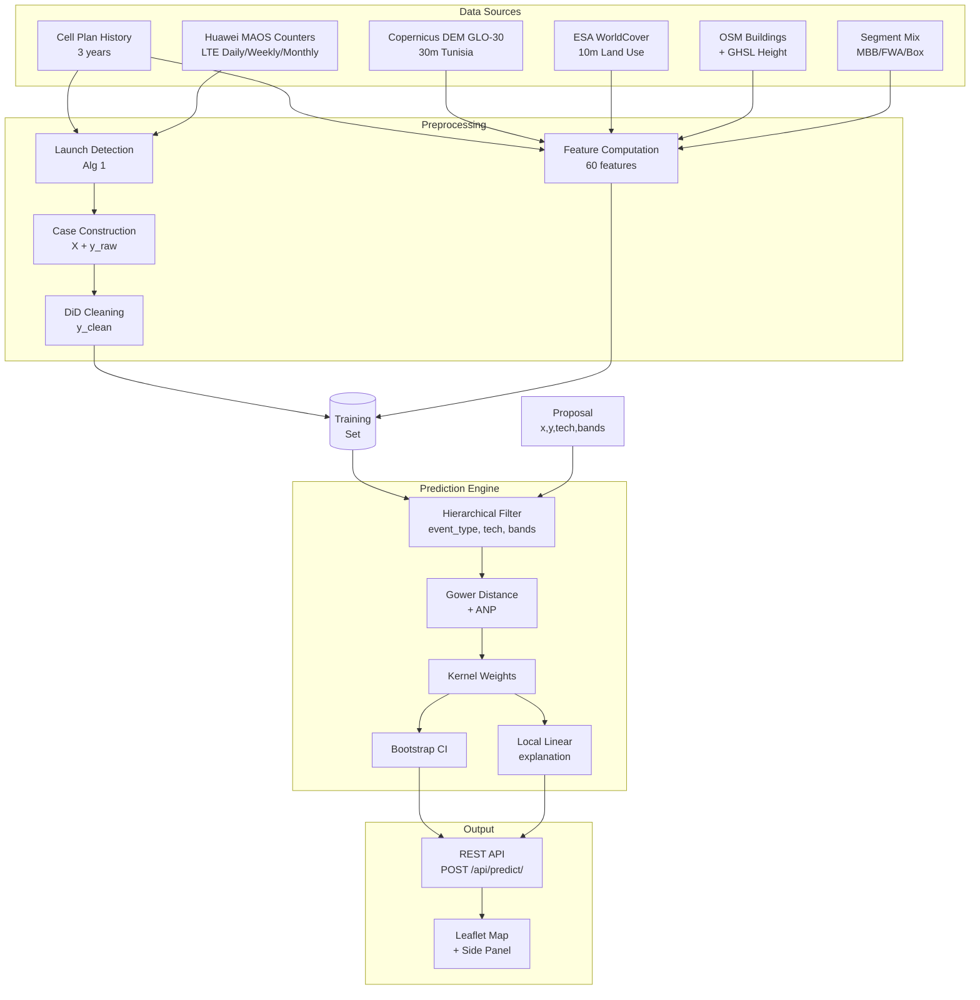
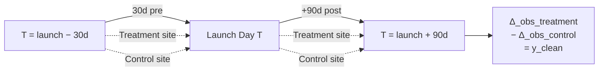
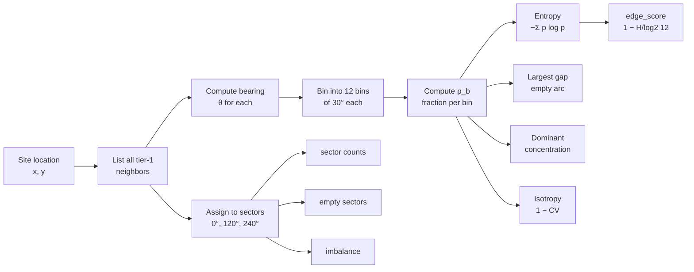
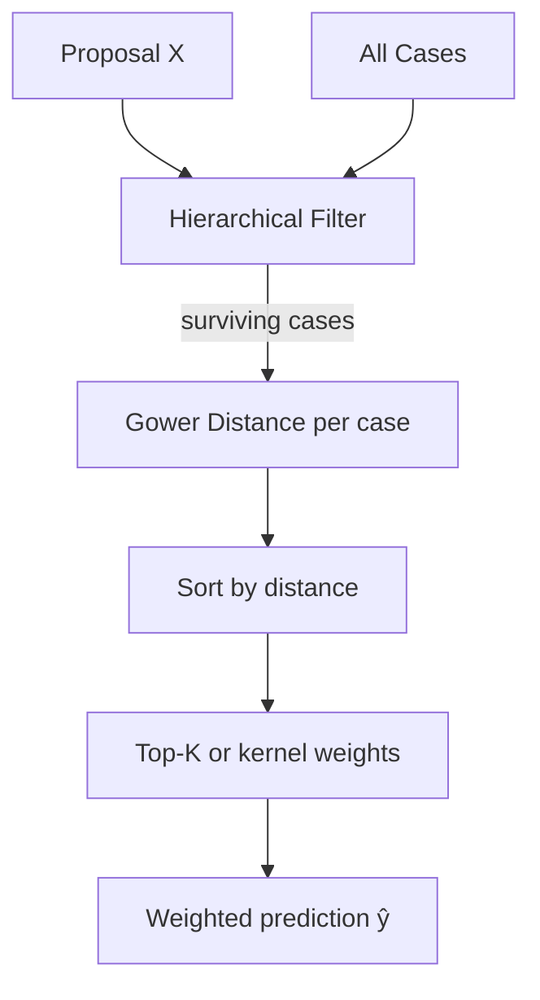
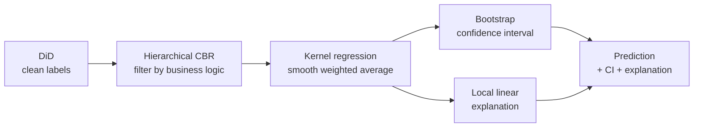
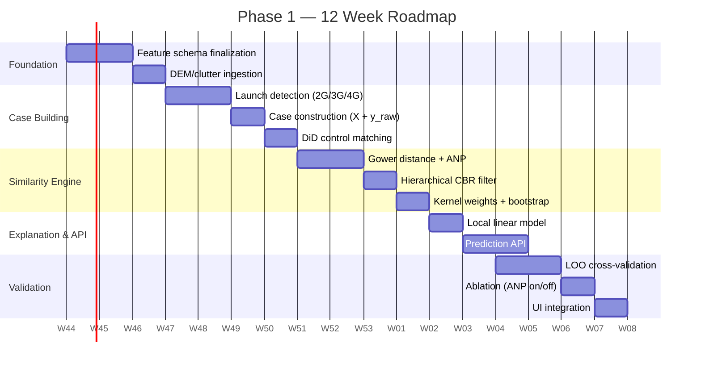

# Smart CAPEX — Phase 1 Specification

## Similarity‑Based Site Attribution with Angular Neighborhood Profile

**Version:** 3.3
**Date:** 2026-10-23
**Scope:** 2G / 3G / 4G only (5G NSA deferred to Phase 2)
**Owner:** Smart CAPEX Project Team

---

## Table of Contents

1. [Executive Summary](#1-executive-summary)
2. [Phase 1 Scope](#2-phase-1-scope)
3. [The Core Idea — Reasoning by Analogy](#3-the-core-idea--reasoning-by-analogy)
4. [Architecture](#4-architecture)
5. [Training Set — Historical Launches as Cases](#5-training-set--historical-launches-as-cases)
6. [Feature Schema](#6-feature-schema)
7. [Angular Neighborhood Profile (ANP)](#7-angular-neighborhood-profile-anp)
8. [Similarity Metric — Gower Distance](#8-similarity-metric--gower-distance)
9. [Prediction — Hierarchical CBR + Kernel Weights](#9-prediction--hierarchical-cbr--kernel-weights)
10. [Worked Example — Edge vs Infill](#10-worked-example--edge-vs-infill)
11. [Methods Comparison &amp; Selection](#11-methods-comparison--selection)
12. [Validation Plan](#12-validation-plan)
13. [Implementation Roadmap](#13-implementation-roadmap)
14. [Risks &amp; Mitigations](#14-risks--mitigations)
15. [Glossary](#15-glossary)

---

## 1. Executive Summary

**Smart CAPEX Phase 1** answers one question:

> *"If I build this site at this location with this configuration, what will the impact be — and what is the NPV?"*

The answer is derived by **reasoning by analogy**: the system finds the **most similar historical launches** from the last 3 years and uses their **measured, causal‑cleaned outcomes** to predict the proposed site's impact.

Phase 1 covers **2G / 3G / 4G** only. No 5G NSA. This simplifies the model and lets us validate the approach on a larger historical dataset before adding 5G complexity.

**Key innovation — Angular Neighborhood Profile (ANP):**
Before matching cases, the system characterizes the **spatial distribution of neighbors around a site** using 360° rotation. This distinguishes **edge sites** (extend coverage) from **infill sites** (relieve capacity) — two categories with radically different economics that would otherwise look identical.

**Deliverables:** 12 weeks, production‑ready prediction API, validation against 3 years of outcomes.

---

## 2. Phase 1 Scope

### 2.1 In Scope

| Area            | Included                                                                 |
| --------------- | ------------------------------------------------------------------------ |
| Technologies    | **2G, 3G, 4G**                                                     |
| Bands           | GSM900, GSM1800, UMTS900, UMTS2100, B20 (800), B3 (1800), B1 (2100)      |
| Event types     | NEW_SITE, TECH_ADD, BAND_ADD, SECTOR_ADD, CAPACITY_ADD, TECH_SUNSET      |
| Client segments | MBB, FWA, FDD Boxies                                                     |
| Data sources    | Huawei M2000 counters, cell plan history, DEM, clutter, buildings        |
| Prediction      | Similarity matching + DiD label cleaning + kernel weights + bootstrap CI |
| Explainability  | Top‑K similar cases + local linear model                                |
| UI              | Map + proposal panel + confidence interval                               |

### 2.2 Out of Scope

| Area                        | Deferred to |
| --------------------------- | ----------- |
| 5G NSA (n41, n78)           | Phase 2     |
| NSA anchor logic            | Phase 2     |
| Synthetic Control Method    | Phase 2     |
| GBDT on similarity features | Phase 2     |
| Siamese network             | Phase 3     |
| Real‑time predictions      | Future      |

---

## 3. The Core Idea — Reasoning by Analogy

```
┌────────────────────────────────────────────────────────────────┐
│                                                                │
│   PROPOSED SITE                      HISTORICAL LAUNCHES       │
│   (x, y, z, config, gap)             (3 years, ~300 cases)     │
│                                                                │
│        │                                    │                  │
│        │                                    │                  │
│        ▼                                    ▼                  │
│   ┌─────────────────────────────────────────────────┐          │
│   │  1. Build feature vector (60 features)          │          │
│   │     - Config: tech, bands, sectors, height      │          │
│   │     - Geometry: z, terrain, aspect              │          │
│   │     - Clutter: urban/rural, buildings           │          │
│   │     - Spatial: neighbors, ANP (360° profile)    │          │
│   │     - Pre‑launch: coverage gap, PRB, RRC        │          │
│   │     - Cluster: size, tech mix                   │          │
│   └─────────────────────────────────────────────────┘          │
│        │                                    │                  │
│        ▼                                    ▼                  │
│   ┌──────────────┐                  ┌──────────────┐           │
│   │  X_proposal  │                  │   X_case_i   │           │
│   └──────┬───────┘                  └──────┬───────┘           │
│          │                                 │                   │
│          └──────────┬──────────────────────┘                   │
│                     ▼                                          │
│           ┌───────────────────┐                                │
│           │  Gower Distance   │ ← mixed numeric/categorical    │
│           │  + ANP features   │                                │
│           └─────────┬─────────┘                                │
│                     ▼                                          │
│           ┌───────────────────┐                                │
│           │  Top‑K similar    │  e.g., Case #42 (d=0.024),     │
│           │  historical cases │        Case #67 (d=0.180), ... │
│           └─────────┬─────────┘                                │
│                     ▼                                          │
│           ┌───────────────────┐                                │
│           │  Kernel weighting │  w_i = exp(-d_i² / 2h²)        │
│           └─────────┬─────────┘                                │
│                     ▼                                          │
│           ┌───────────────────┐                                │
│           │  ŷ = Σ w_i·y_i    │  Δ coverage, Δ PRB, Δ traffic, │
│           │  + Bootstrap CI   │  NPV, payback                  │
│           └─────────┬─────────┘                                │
│                     ▼                                          │
│           ┌───────────────────┐                                │
│           │  Prediction + CI  │                                │
│           │  + top‑5 cases    │                                │
│           │  + explanation    │                                │
│           └───────────────────┘                                │
│                                                                │
└────────────────────────────────────────────────────────────────┘
```

The model learns **nothing abstract** — it learns **which past sites are like this one**, and inherits their observed outcomes.

---

## 4. Architecture



**Key components:**

- **Preprocessing** runs **once per data refresh** (monthly). Produces the training set.
- **Prediction** runs **per proposal** (on‑demand, < 2 sec).
- **API** returns point estimate + confidence interval + top‑K cases + explanation.

---

## 4.1 Geographic Data Sources for Tunisia

Phase 1 uses publicly available, high-quality geographic datasets for Tunisia to compute geometry, clutter, and building features.

### 4.1.1 Digital Elevation Model (DEM)

**Source:** Copernicus DEM GLO-30 (Global 30m)  
**Provider:** European Space Agency (ESA) / Airbus Defence and Space  
**Coverage:** Global (includes all of Tunisia)  
**Resolution:** 30m horizontal, ~2m vertical accuracy  
**Format:** GeoTIFF  
**Access:** Free download via https://portal.opentopography.org/  
**License:** Open data (Copernicus terms)  
**Use Cases:**
- `z_antenna_m`: Antenna elevation above sea level
- `terrain_slope_deg`: Median slope in 200m buffer
- `terrain_roughness_m`: Elevation standard deviation in 1km
- `terrain_aspect_deg`: Dominant slope direction

**Tunisia Coverage:** Full country, tiles `N30E007` through `N38E012`

**Antenna Height Formula:**
```python
z_antenna_m = DEM.sample(site.lon, site.lat) + antenna_height_m
# Default antenna_height_m = 25m if not in cell plan
# Default total height = DEM + building_height + 15m pole = DEM + 12m + 15m = DEM + 27m
```

### 4.1.2 Land Cover / Clutter

**Source:** ESA WorldCover v200 (2021 baseline)  
**Provider:** European Space Agency  
**Coverage:** Global (includes Tunisia)  
**Resolution:** 10m  
**Format:** GeoTIFF  
**Access:** Free download via https://esa-worldcover.org/  
**License:** CC BY 4.0  
**Classes (11 types):**
1. Tree cover (forest)
2. Shrubland
3. Grassland
4. Cropland
5. Built-up (urban/suburban)
6. Bare/sparse vegetation
7. Snow and ice
8. Permanent water bodies
9. Herbaceous wetland
10. Mangroves
11. Moss and lichen

**Mapping to Smart CAPEX Clutter Categories:**
- **Urban:** Class 5 (Built-up) + building density > 40%
- **Suburban:** Class 5 (Built-up) + building density 10-40%
- **Rural:** Classes 1-4 (vegetation/cropland)
- **Water:** Class 8
- **Forest:** Class 1

**Use Cases:**
- `dominant_clutter`: Mode of land cover in 500m buffer
- `clutter_entropy_2km`: Diversity metric (−Σ p log₂ p) in 2km

### 4.1.3 Building Footprints

**Source:** OpenStreetMap (OSM) Tunisia Extract  
**Provider:** OpenStreetMap Foundation  
**Coverage:** Tunisia (variable completeness: 80%+ in urban areas, 40%+ rural)  
**Format:** GeoJSON / Shapefiles (via Overpass API or Geofabrik)  
**Access:** Free download via https://download.geofabrik.de/africa/tunisia.html  
**License:** ODbL (Open Database License)  
**Attributes:**
- Geometry: Building polygon footprints
- Tags: `building=yes/residential/commercial/...`
- Height: Sparse (< 5% of buildings have `height` tag)

**Use Cases:**
- `pct_building_area_1km`: (Σ building area / buffer area) × 100

### 4.1.4 Building Heights

**Primary Source:** Global Human Settlement Layer (GHSL) - Built Heights (GHS-BUILT-H R2023A)  
**Provider:** European Commission Joint Research Centre  
**Coverage:** Global 100m grid  
**Resolution:** 100m (mean building height per cell)  
**Format:** GeoTIFF  
**Access:** Free download via https://ghsl.jrc.ec.europa.eu/  
**License:** CC BY 4.0  
**Epoch:** 2020  
**Accuracy:** ±3m in urban areas, ±5m rural (validated against LIDAR)

**Fallback Method (if GHSL unavailable):**
Use clutter-based defaults:
```python
building_height_defaults = {
    'urban': 12.0,      # 3-4 floors
    'suburban': 8.0,    # 2-3 floors
    'rural': 6.0,       # 1-2 floors
    'forest': 0.0,
    'water': 0.0
}
avg_building_height_m = building_height_defaults.get(dominant_clutter, 0.0)
```

**Use Cases:**
- `avg_building_height_m`: Mean GHSL height in 1km buffer
- Antenna height offset: `z_antenna = DEM + building_height + 15m` (default 27m total offset)

### 4.1.5 Data Ingestion Pipeline

```python
# Pseudo-code for Tunisia geographic feature extraction
def extract_geo_features(site_lat, site_lon):
    # 1. DEM features
    dem_value = copernicus_dem.sample(lon=site_lon, lat=site_lat)
    slope = compute_slope(copernicus_dem, buffer_m=200)
    roughness = compute_roughness(copernicus_dem, buffer_m=1000)
    aspect = compute_aspect(copernicus_dem, buffer_m=200)
    
    # 2. Land cover
    landcover_buffer = esa_worldcover.sample_buffer(
        lon=site_lon, lat=site_lat, radius_m=500
    )
    dominant_clutter = mode(landcover_buffer)
    
    landcover_2km = esa_worldcover.sample_buffer(
        lon=site_lon, lat=site_lat, radius_m=2000
    )
    clutter_entropy = compute_entropy(landcover_2km)
    
    # 3. Building footprints
    buildings = osm_buildings.intersect_buffer(
        lon=site_lon, lat=site_lat, radius_m=1000
    )
    pct_building_area = (sum(b.area for b in buildings) / 
                          (np.pi * 1000**2)) * 100
    
    # 4. Building heights
    ghsl_heights = ghsl_built_h.sample_buffer(
        lon=site_lon, lat=site_lat, radius_m=1000
    )
    avg_building_height = mean(ghsl_heights) if ghsl_heights else \
                          building_height_defaults[dominant_clutter]
    
    # 5. Antenna elevation
    antenna_height = site.antenna_height_m or 25.0  # Default 25m
    z_antenna = dem_value + antenna_height
    
    return {
        'z_antenna_m': z_antenna,
        'terrain_slope_deg': slope,
        'terrain_roughness_m': roughness,
        'terrain_aspect_deg': aspect,
        'dominant_clutter': dominant_clutter,
        'clutter_entropy_2km': clutter_entropy,
        'pct_building_area_1km': pct_building_area,
        'avg_building_height_m': avg_building_height
    }
```

### 4.1.6 Static Assumptions for Cell Configuration

**Cell geometry assumed constant over observation period:**
- **Longitude/Latitude:** Fixed (no site relocation)
- **Azimuth:** Fixed per sector (no repointing)
- **TX mode:** Fixed (no MIMO upgrades mid-observation)

**Rationale:** Cell plan changes (azimuth adjustment, MIMO upgrades) are rare (< 2% of cells per year) and would require separate event detection. Phase 1 treats these as frozen at T-30d snapshot.

**Impact Measurement:**
- Traffic impact measured using KPI-based detection (see Section 5.1)
- Cell geometry used only for spatial feature computation
- Changes to geometry between T-30d and T+90d would be detected as separate CAPACITY_ADD events

---

## 5. Training Set — Historical Launches as Cases

### 5.1 Event Detection Methodology — KPI-Based Launch Detection

**Launch events are detected using KPI-based analysis, not cell plan diffs.**

A cell is considered "launched" at timestamp T if:

```
Cell is added at T if:
  1. L.Traffic.User.Avg > 0  OR  L.Thrp.bits.DL > 0  at timestamp T
  AND
  2. Cell had NO data traffic in entire historical record before T
     (not just T-1, but all available history)
```

**Algorithm:**

```python
def detect_launch_date(cell_id, kpi_timeseries):
    """
    Detect launch date for a cell using KPI-based method.
    
    Args:
        cell_id: Cell identifier
        kpi_timeseries: DataFrame with columns [timestamp, L.Traffic.User.Avg, L.Thrp.bits.DL]
                       sorted by timestamp ascending
    
    Returns:
        launch_date: First timestamp where cell had traffic, or None if never launched
    """
    # Find first timestamp where cell has traffic
    for idx, row in kpi_timeseries.iterrows():
        if row['L.Traffic.User.Avg'] > 0 or row['L.Thrp.bits.DL'] > 0:
            launch_date = row['timestamp']
            
            # Verify NO traffic existed before this timestamp in entire history
            pre_launch_data = kpi_timeseries[kpi_timeseries['timestamp'] < launch_date]
            
            has_pre_traffic = (
                (pre_launch_data['L.Traffic.User.Avg'] > 0).any() or
                (pre_launch_data['L.Thrp.bits.DL'] > 0).any()
            )
            
            if not has_pre_traffic:
                return launch_date
    
    return None  # Cell never launched in observed period
```

**Rationale:**

- **Cell plan diffs are unreliable**: Cells may be added to configuration but not activated, or may have incorrect effective dates
- **KPI > 0 is ground truth**: If users connect and generate traffic, the cell is operationally live
- **Full history check prevents false positives**: A cell with traffic at T-2 that goes quiet at T-1 then resumes at T is NOT a new launch
- **Two KPI signals for robustness**: `L.Traffic.User.Avg` catches voice/signaling, `L.Thrp.bits.DL` catches data

**Edge Cases:**

| Scenario | Handling |
|----------|----------|
| Cell activated then immediately deactivated | Launch date = first activation; subsequent reactivation is NOT a new launch |
| Cell with intermittent outages | Launch date = first traffic timestamp; outages do not reset launch status |
| Cell configuration change (bandwidth, MIMO) | NOT detected as launch; capacity changes handled separately via config diff |
| Cell with only UL traffic | NOT detected (requires DL traffic as primary signal) |

**Event Type Classification (after launch detection):**

Once launch timestamp T is identified, classify the event type by comparing cell/site configuration at T-30d vs T+1d:

```python
def classify_event_type(site_id, cell_id, launch_date):
    config_before = get_site_config(site_id, launch_date - timedelta(days=30))
    config_after = get_site_config(site_id, launch_date + timedelta(days=1))
    
    if site_id not in config_before.sites:
        return "NEW_SITE"
    
    techs_before = set(config_before.technologies)
    techs_after = set(config_after.technologies)
    
    if len(techs_after - techs_before) > 0:
        return "TECH_ADD"
    
    bands_before = set(config_before.bands)
    bands_after = set(config_after.bands)
    
    if len(bands_after - bands_before) > 0:
        return "BAND_ADD"
    
    sectors_before = len(config_before.sectors)
    sectors_after = len(config_after.sectors)
    
    if sectors_after > sectors_before:
        return "SECTOR_ADD"
    
    bw_before = sum(cell.bandwidth for cell in config_before.cells)
    bw_after = sum(cell.bandwidth for cell in config_after.cells)
    
    if bw_after > bw_before:
        return "CAPACITY_ADD"
    
    if len(techs_before - techs_after) > 0:
        return "TECH_SUNSET"
    
    return "UNKNOWN"  # Flag for manual review
```

### 5.2 Unit of the Dataset

Each **launch event** — not each site — is one training row. A site can contribute multiple cases over 3 years.

```
SITE_0421 Timeline
────────────────────────────────────────────────────────────────
2021-05  │  NEW_SITE (2G GSM900)                → Case #1
2022-03  │  TECH_ADD (+3G UMTS2100)             → Case #2
2023-09  │  TECH_ADD (+4G B3+B20)               → Case #3  ⬅ used in example
2024-02  │  CAPACITY_ADD (B3: 20→40 MHz)        → Case #4
2024-11  │  SECTOR_ADD (3rd sector)             → Case #5
────────────────────────────────────────────────────────────────
```

Each case captures:

| Component     | Description                                                   |
| ------------- | ------------------------------------------------------------- |
| `X_i`       | Feature vector (60 features) computed at **T−30 days** |
| `y_i^raw`   | Raw KPI deltas from T−30d to T+90d                           |
| `y_i^clean` | **DiD‑corrected** deltas (see §5.2)                   |
| `gain_i`    | Financial gain from clean deltas                              |
| `cfg_i`     | Configuration snapshot                                        |

### 5.2 Label Cleaning — Difference‑in‑Differences

Raw deltas are contaminated by **network‑wide trends** (all traffic grows 5%/year). Fix:

```
For launch L_i at time T_i:

    treatment = site_i, window [T_i − 30d, T_i + 90d]
    control   = most similar site to site_i that did NOT launch in same window

    Δ_obs_treatment = KPI(T_i + 90d) − KPI(T_i − 30d)   ← raw
    Δ_obs_control   = KPI_control(+90d) − KPI_control(−30d)

    y_clean = Δ_obs_treatment − Δ_obs_control          ← used for training
```



**Control matching:** the most similar site that did **not** launch in the same window, using the same Gower distance.

### 5.3 Dataset Size

For a typical operator region with 800 sites over 3 years:

| Event Type                | Expected count       |
| ------------------------- | -------------------- |
| NEW_SITE (2G/3G/4G)       | ~120                 |
| TECH_ADD (2G→3G, 3G→4G) | ~180                 |
| BAND_ADD                  | ~80                  |
| SECTOR_ADD                | ~60                  |
| CAPACITY_ADD              | ~100                 |
| TECH_SUNSET               | ~40                  |
| **Total**           | **~580 cases** |

580 training examples is **enough for stable similarity matching** (Methods A–I in §11). Not enough for deep learning (Method H) — but that is not Phase 1.

---

## 6. Feature Schema

**56 features in Phase 1** (59 total with Phase 2) in **6 groups**. Every new feature added later must fit one of these groups.

### 6.1 Configuration (weight 0.28, 10 features)

Captures **what is being built**.

| Feature                       | Type                                                      | Source                         |
| ----------------------------- | --------------------------------------------------------- | ------------------------------ |
| `event_type`                | categorical                                               | Launch Detection               |
| `tech_added`                | categorical (2G/3G/4G)                                    | Cell plan diff                 |
| `tech_before`               | binary vector [2G,3G,4G]                                  | Cells active at T−30d         |
| `tech_after`                | binary vector                                             | `tech_before ∪ tech_added`  |
| `bands_added`               | binary vector [GSM900,GSM1800,UMTS900,UMTS2100,B20,B3,B1] | Cell plan diff                 |
| `sector_count_after`        | integer                                                   | `len(distinct azimuth)`      |
| `cells_per_sector_after`    | float                                                     | `total_cells / sectors`      |
| `antenna_height_m`          | float                                                     | Cell plan                      |
| `total_bw_after_mhz`        | float                                                     | `Σ cell.bandwidth_mhz`      |
| `total_capacity_after_mbps` | float                                                     | `Σ bw × SE × MIMO_layers` |

### 6.2 Geometry (weight 0.05, 4 features)

Captures **where the site sits on the terrain**.

| Feature                 | Type             | Formula                           |
| ----------------------- | ---------------- | --------------------------------- |
| `z_antenna_m`         | float            | `DEM(x,y) + antenna_height_m`   |
| `terrain_slope_deg`   | float            | `median(arctan(∇DEM))` in 200m |
| `terrain_roughness_m` | float            | `std(DEM)` in 1km               |
| `terrain_aspect_deg`  | float (circular) | `atan2(−dH/dy, dH/dx) mod 360` |

### 6.3 Clutter / Topology (weight 0.13, 4 features)

Captures **what is on the ground**.

| Feature                   | Type        | Formula                                   |
| ------------------------- | ----------- | ----------------------------------------- |
| `dominant_clutter`      | categorical | Mode of clutter raster in 500m            |
| `clutter_entropy_2km`   | float       | `−Σ p_c log2(p_c)` in 2km             |
| `pct_building_area_1km` | float       | `Σ building_area / area_buffer × 100` |
| `avg_building_height_m` | float       | Mean height in 1km                        |

### 6.4 Spatial Context (weight 0.20, 23 features)

Captures **network topology around the site**.

**Legacy features (8):**

| Feature                           | Type    | Formula                         |
| --------------------------------- | ------- | ------------------------------- |
| `dist_nearest_site_m`           | float   | `min(haversine to all sites)` |
| `n_sites_1km`                   | integer | Count in 1km                    |
| `n_sites_2km`                   | integer | Count in 2km                    |
| `n_sites_3km`                   | integer | Count in 3km                    |
| `n_2g_sites_2km`                | integer | Sites with 2G in 2km            |
| `n_3g_sites_2km`                | integer | Sites with 3G in 2km            |
| `n_4g_sites_2km`                | integer | Sites with 4G in 2km            |
| `neighbor_avg_antenna_height_m` | float   | Mean of neighbors               |

**ANP features (15) — the new family — see §7 for full detail.**

### 6.5 Pre‑Launch State (weight 0.27, 9 features in Phase 1)

Captures **the gap being solved**. Measured 30 days before launch.

| Feature                     | Type  | Formula                             | Phase       |
| --------------------------- | ----- | ----------------------------------- | ----------- |
| `coverage_ratio_pre`      | float | `Σ 𝟙(RSRP>−110) / N`           | 1           |
| `coverage_gap_pre`        | float | `1 − coverage_ratio_pre`         | 1           |
| `avg_prb_pre`             | float | Weighted mean PRB over cells        | 1           |
| `avg_rrc_pre`             | float | Mean RRC connected users            | 1           |
| `avg_throughput_pre`      | float | Mean DL user throughput (Mbps)      | 1           |
| `avg_latency_pre`         | float | Mean P95 latency (ms)               | 1           |
| `dl_traffic_pre_gb_day`   | float | Σ DL traffic (GB/day)              | 1           |
| `traffic_ratio_pre`       | float | `mean(demand/capacity)`           | 1           |
| `gap_score_pre`           | float | `α·cov_gap + β·traffic_ratio` | 1           |
| `traffic_density_mbb_pre` | float | KDE density (GB/day/km²)           | **2** |
| `traffic_density_fwa_pre` | float | KDE density                         | **2** |
| `traffic_density_box_pre` | float | KDE density                         | **2** |

**Phase 2 features** (MBB/FWA/Boxies traffic density) require IMEI-to-subscriber database join to segment traffic by device type. Phase 1 uses aggregate traffic metrics without device segmentation.

### 6.6 Cluster Context (weight 0.05, 6 features)

Captures **position within network cluster**.

| Feature                  | Type    | Formula                             |
| ------------------------ | ------- | ----------------------------------- |
| `cluster_size`         | integer | Count of sites in cluster           |
| `cluster_radius_m`     | float   | `1.5 × median pairwise distance` |
| `cluster_pct_4g`       | float   | Fraction of 4G cells                |
| `cluster_pct_3g`       | float   | Fraction of 3G cells                |
| `cluster_pct_2g`       | float   | Fraction of 2G cells                |
| `site_rank_in_cluster` | integer | Chronological rank                  |

### 6.7 Weight Summary

| Group                                 | Weight         | Feature count Phase 1 | Feature count Phase 2 |
| ------------------------------------- | -------------- | --------------------- | --------------------- |
| Configuration                         | 0.28           | 10                    | 10                    |
| Pre‑launch state                     | 0.27           | 10                    | 13                    |
| **Spatial context (incl. ANP)** | **0.20** | **23**          | **23**          |
| Clutter / topology                    | 0.13           | 4                     | 4                     |
| Geometry                              | 0.05           | 4                     | 4                     |
| Cluster context                       | 0.05           | 6                     | 6                     |
| **Total**                       | **1.00** | **57**          | **60**          |

---

## 7. Angular Neighborhood Profile (ANP)

### 7.1 The Intuition

Two sites with **identical** `n_sites_2km = 5` can be radically different:

```
════════════════════════════════════════════════════════════════
  SITE A — Edge                           SITE B — Infill
════════════════════════════════════════════════════════════════

         N                                       N
         │                                       │
    NW   │   NE                              NW  │  NE
     \   │  /                                   │
      \  │ /                                    │
       \ │/                              W ─────┼───── E
    W───★───E                                     │
       /│\                                      │
      / │ \                                     │
     /  │  \                                    │
    SW  │   SE                                 SW│SE
        S                                        S

  5 neighbors clustered                     5 neighbors evenly
  in NE 120° arc.                           spread in 360°.

  → EDGE SITE                               → INFILL SITE
  → coverage-driven                         → capacity-driven
  → +coverage gain                          → +capacity gain
  → weak capacity gain                      → weak coverage gain
════════════════════════════════════════════════════════════════
```

**Without ANP:** both sites look the same → model predicts average → wrong for both.
**With ANP:** `edge_score` distinguishes them → model matches correctly.

### 7.2 The 15 ANP Features

#### Tier counts (3)

| Feature            | Formula                                  | Range    |
| ------------------ | ---------------------------------------- | -------- |
| `n_tier1`        | Sites with `distance ≤ 2000 m`        | 0 – 50  |
| `n_tier2`        | Sites with `2000 < distance ≤ 5000 m` | 0 – 100 |
| `t1_to_t2_ratio` | `n_tier1 / max(n_tier2, 1)`            | 0 – 2   |

#### Distance features (2)

| Feature                | Formula                       |
| ---------------------- | ----------------------------- |
| `t1_nearest_m`       | Min distance to tier-1 site   |
| `t1_mean_distance_m` | Mean distance to tier-1 sites |

#### Angular distribution — the rotation (5)

Compute bearing `θ_i` to each tier-1 neighbor. Bin into **12 bins of 30°**.

| Feature                       | Formula                      | Range     | Meaning                            |
| ----------------------------- | ---------------------------- | --------- | ---------------------------------- |
| `t1_angular_entropy`        | `−Σ p_b log2(p_b)`       | 0 – 3.58 | 3.58 = uniform, 0 = one direction  |
| `t1_angular_gap_deg`        | Largest contiguous empty arc | 0 – 360  | 360 = no neighbors, 0 = surrounded |
| `t1_dominant_concentration` | `max(bin) / total`         | 0 – 1    | 1 = clustered, 1/12 = uniform      |
| `t1_isotropy`               | `1 − CV(bins)`            | 0 – 1    | 1 = uniform, 0 = extreme           |
| `edge_score`                | `1 − entropy / log2(12)`  | 0 – 1    | **1 = edge, 0 = infill**     |

#### Sector alignment (5)

Assign each neighbor to the nearest sector boresight (0°, 120°, 240°).

| Feature                | Formula                        | Range   |
| ---------------------- | ------------------------------ | ------- |
| `sector_0_count`     | Neighbors assigned to sector 0 | 0 – 50 |
| `sector_1_count`     | Neighbors assigned to sector 1 | 0 – 50 |
| `sector_2_count`     | Neighbors assigned to sector 2 | 0 – 50 |
| `sector_empty_count` | Sectors with 0 neighbors       | 0 – 3  |
| `sector_imbalance`   | `max − min` across sectors  | 0 – 3  |

**Total: 3 + 2 + 5 + 5 = 15 features.**

### 7.3 Visual — The Rotation



### 7.4 Reference Implementation

```python
import numpy as np
from math import atan2, degrees, radians, sin, cos, sqrt

def bearing(lat1, lon1, lat2, lon2):
    phi1, phi2 = radians(lat1), radians(lat2)
    dlon = radians(lon2 - lon1)
    y = sin(dlon) * cos(phi2)
    x = cos(phi1) * sin(phi2) - sin(phi1) * cos(phi2) * cos(dlon)
    return (degrees(atan2(y, x)) + 360) % 360

def haversine_m(lat1, lon1, lat2, lon2):
    R = 6371000
    p1, p2 = radians(lat1), radians(lat2)
    dp, dl = p2 - p1, radians(lon2 - lon1)
    a = sin(dp/2)**2 + cos(p1)*cos(p2)*sin(dl/2)**2
    return R * 2 * atan2(sqrt(a), sqrt(1 - a))

def compute_anp(site, existing_sites, boresights=(0, 120, 240),
                tier1_m=2000, tier2_m=5000, n_bins=12):
    # Bearings and distances
    neighbors = []
    for s in existing_sites:
        d = haversine_m(site['lat'], site['lon'], s['lat'], s['lon'])
        if d < 1:   # skip self
            continue
        b = bearing(site['lat'], site['lon'], s['lat'], s['lon'])
        neighbors.append({'dist': d, 'bearing': b})
  
    tier1 = [n for n in neighbors if n['dist'] <= tier1_m]
    tier2 = [n for n in neighbors if tier1_m < n['dist'] <= tier2_m]
  
    feats = {
        'n_tier1': len(tier1),
        'n_tier2': len(tier2),
        't1_to_t2_ratio': len(tier1) / max(len(tier2), 1),
        't1_nearest_m': min((n['dist'] for n in tier1), default=tier1_m),
        't1_mean_distance_m': np.mean([n['dist'] for n in tier1]) if tier1 else tier1_m,
    }
  
    # Angular distribution
    if len(tier1) >= 2:
        bearings = np.array([n['bearing'] for n in tier1])
        bins, _ = np.histogram(bearings, bins=n_bins, range=(0, 360))
        p = bins / bins.sum()
    
        entropy = -np.sum(p[p > 0] * np.log2(p[p > 0]))
        max_entropy = np.log2(n_bins)
    
        # Largest empty arc
        gap_bins = 0
        for start in range(n_bins):
            if bins[start] == 0:
                run = 0
                for j in range(1, n_bins + 1):
                    if bins[(start + j) % n_bins] == 0:
                        run += 1
                    else:
                        break
                gap_bins = max(gap_bins, run)
        gap_deg = gap_bins * (360 / n_bins)
    
        feats.update({
            't1_angular_entropy': float(entropy),
            't1_angular_gap_deg': float(gap_deg),
            't1_dominant_concentration': float(bins.max() / bins.sum()),
            't1_isotropy': float(max(0, 1 - bins.std() / (bins.mean() + 1e-6) / np.sqrt(n_bins))),
            'edge_score': float(1 - entropy / max_entropy),
        })
    else:
        feats.update({
            't1_angular_entropy': 0.0,
            't1_angular_gap_deg': 360.0,
            't1_dominant_concentration': 1.0,
            't1_isotropy': 0.0,
            'edge_score': 1.0,
        })
  
    # Sector alignment
    counts = [0] * len(boresights)
    for n in tier1:
        nearest = min(range(len(boresights)),
                      key=lambda k: min(abs(n['bearing'] - boresights[k]),
                                        360 - abs(n['bearing'] - boresights[k])))
        counts[nearest] += 1
  
    feats.update({f'sector_{k}_count': counts[k] for k in range(len(boresights))})
    feats['sector_empty_count'] = sum(1 for c in counts if c == 0)
    feats['sector_min_count'] = min(counts)
    feats['sector_max_count'] = max(counts)
    feats['sector_imbalance'] = max(counts) - min(counts)
  
    return feats
```

**Runtime:** ~5 ms per site. Negligible.

### 7.5 Rotation‑Invariant vs Absolute

**Rotation‑invariant (used):** `entropy`, `gap_deg`, `isotropy`, `dominant_concentration`, `sector_empty_count`, `sector_imbalance`

**Absolute (NOT used):** `gap_bearing`, `dominant_bearing`

**Why drop absolute bearings:** A site whose neighbors are to the north is "different" from a site whose neighbors are to the south — even though both are **edge sites**. The model should learn "this looks like an edge site," not "this looks like a north‑facing edge site." Rotation invariance reduces the training data needed by 4×.

**Note:** If you have > 500 cases and want to test whether compass adds signal, add `angular_gap_bearing` as **circular distance** `min(|a−b|, 360−|a−b|) / 180`. Start without it.

---

## 8. Similarity Metric — Gower Distance

### 8.1 Formula

Gower handles **mixed numeric + categorical** features cleanly:

```
d(A, B) = Σ_f  w_f · δ_f(A, B)  /  Σ_f  w_f

Where:
  δ_f = |A_f − B_f| / range_f     for numeric features
  δ_f = 0 if A_f == B_f else 1    for categorical features
  w_f = feature weight
```

**At the group level** (for readability in the example):

```
d = Σ_g  W_g · ( Σ_{f∈g} δ_f / |g| )
```

### 8.2 Computation Order



### 8.3 Normalization

Each numeric feature is divided by its **range in the training set**. Store the ranges:

| Feature                   | Range |
| ------------------------- | ----- |
| `antenna_height_m`      | 45    |
| `z_antenna_m`           | 180   |
| `terrain_slope_deg`     | 25    |
| `terrain_roughness_m`   | 40    |
| `clutter_entropy_2km`   | 1.5   |
| `pct_building_area_1km` | 90    |
| `avg_building_height_m` | 40    |
| `dist_nearest_site_m`   | 2950  |
| `n_sites_1km`           | 10    |
| `n_sites_2km`           | 25    |
| `n_sites_3km`           | 50    |
| `n_tier1`               | 20    |
| `n_tier2`               | 60    |
| `t1_angular_entropy`    | 3.58  |
| `t1_angular_gap_deg`    | 360   |
| `avg_prb_pre`           | 100   |
| `avg_rrc_pre`           | 800   |
| `avg_throughput_pre`    | 80    |
| `avg_latency_pre`       | 95    |
| `dl_traffic_pre_gb_day` | 800   |
| `traffic_ratio_pre`     | 10    |
| `cluster_radius_m`      | 3500  |

Recomputed on every retrain.

---

## 9. Prediction — Hierarchical CBR + Kernel Weights

### 9.1 The Algorithm

```mermaid
flowchart TD
    A[Proposal:<br/>x, y, tech, bands, h, sectors] --> B[Step 1: Compute z from DEM]
    B --> C[Step 2: Compute 60 features<br/>incl. ANP]
    C --> D{Step 3: Hierarchical Filter}
    D -->|1| E[Keep cases with<br/>same event_type]
    E -->|2| F[Keep cases with<br/>same tech_added]
    F -->|3| G[Keep cases with<br/>bands overlap ≥ 50%]
    G -->|pool < 3?| H[Relax filters]
    H --> G
    G -->|pool ≥ 3| I[Step 4: Gower distance<br/>for each case in pool]
    I --> J[Step 5: Kernel weights<br/>w_i = exp(−d_i² / 2h²)]
    J --> K[Step 6: ŷ = Σ w_i y_i / Σ w_i]
    K --> L[Step 7: Bootstrap CI<br/>1000 resamples]
    L --> M[Step 8: Local linear model<br/>explanation]
    M --> N[Return prediction<br/>+ CI + top‑5 + explanation]
```

### 9.2 Hierarchical Filter Logic

```
Filter 1: event_type match
    If |pool| < 3: skip
    Else: keep cases with same event_type

Filter 2: tech_added match
    If |pool| < 3: relax Filter 1 (any event_type)
    Else: keep cases with same tech_added

Filter 3: bands_added overlap ≥ 50%
    If |pool| < 3: relax Filter 3 (any bands)
    Else: keep cases with band overlap ≥ 50%

Fallback: if pool < 3 after all relaxations:
    use global model (all cases), flag low confidence
```

### 9.3 Kernel Weights

```
Bandwidth h = median(pairwise distances across training set)
             (typically ~0.20)

w_i = exp(−d_i² / (2h²))

Normalize: w_i / Σ w_i
```

If `d_i = 0` (identical): `w_i = 1` (max).
If `d_i = h`: `w_i ≈ 0.61`.
If `d_i = 2h`: `w_i ≈ 0.14`.
If `d_i = 3h`: `w_i ≈ 0.01` (negligible).

This smoothly fades distant cases — no arbitrary K cutoff.

### 9.4 Bootstrap Confidence Interval

```
For b in 1..1000:
    resample the pool with replacement
    reweight by kernel
    ŷ_b = Σ w_i y_i^resample / Σ w_i

CI_low = 5th percentile of {ŷ_b}
CI_high = 95th percentile of {ŷ_b}
```

Wide CI = disagreement among top cases. Narrow CI = strong consensus.

### 9.5 Explanation — Local Linear Model

Fit a linear model on the **top 15 nearest cases**:

```
y_i ≈ β_0 + Σ_f β_f · x_{i,f}     (for top 15 cases)

For proposal: ŷ_local = β_0 + Σ_f β_f · x_{proposal,f}
Explanation:  top |β_f| features
```

This gives human‑readable drivers:

> *"The high PRB drop (ΔPRB = −17) is driven by pre‑launch PRB of 81% (β = 0.42) and 2 cells per sector (β = 0.31)."*

---

## 10. Worked Example — Edge vs Infill

### 10.1 The Two Proposals

Both proposals are **4G TECH_ADD** on a **2G+3G site**, with **5 existing sites within 2 km**. On paper they look identical.

| Attribute           | **Proposal A (Edge)** | **Proposal B (Infill)** |
| ------------------- | --------------------------- | ----------------------------- |
| Location (x, y)     | 10.242° E, 36.852° N      | 10.288° E, 36.821° N        |
| DEM elevation       | 62 m                        | 58 m                          |
| Antenna height      | 25 m                        | 25 m                          |
| **z_antenna** | **87 m**              | **83 m**                |
| Sectors             | 3                           | 3                             |
| Cells/sector        | 1                           | 1                             |
| Tech added          | 4G                          | 4G                            |
| Bands               | B3 (20) + B20 (10)          | B3 (20) + B20 (10)            |
| Total BW            | 30 MHz                      | 30 MHz                        |
| Total capacity      | 560 Mbps                    | 560 Mbps                      |
| **n_tier1**   | **5**                 | **5**                   |
| **n_tier2**   | **15**                | **15**                  |

### 10.2 The ANP Computation

#### Proposal A — Neighbors clustered NE

Neighbor bearings (all tier‑1):

```
θ = [15°, 40°, 65°, 85°, 105°]
```

Bin into 12 bins of 30°:

```
Bin 0 (  0- 30°)  │ █
Bin 1 ( 30- 60°)  │ ██
Bin 2 ( 60- 90°)  │ ██
Bin 3 ( 90-120°)  │ █
Bin 4-11          │ (empty)
```

ANP features:

| Feature                              | Computation                                     | Value           |
| ------------------------------------ | ----------------------------------------------- | --------------- |
| `n_tier1`                          | —                                              | 5               |
| `n_tier2`                          | —                                              | 15              |
| `t1_to_t2_ratio`                   | 5/15                                            | 0.33            |
| `t1_nearest_m`                     | min distance                                    | 310             |
| `t1_mean_distance_m`               | mean distance                                   | 890             |
| `t1_angular_entropy`               | `−Σ p log2 p`, p=[1/5, 2/5, 2/5]            | **1.52**  |
| `t1_angular_gap_deg`               | Largest empty arc (bins 4-11 → 8 bins × 30°) | **240°** |
| `t1_dominant_concentration`        | `max / total` = 2/5                           | **0.40**  |
| `t1_isotropy`                      | `1 − CV/√12`                                | **0.35**  |
| `edge_score`                       | `1 − 1.52/3.58`                              | **0.575** |
| `sector_0_count` (0° boresight)   | 2 (bearings 15°, 40°)                         | 2               |
| `sector_1_count` (120° boresight) | 3 (bearings 65°, 85°, 105°)                  | 3               |
| `sector_2_count` (240° boresight) | 0                                               | 0               |
| `sector_empty_count`               | —                                              | **1**     |
| `sector_imbalance`                 | max − min                                      | **3**     |

**Interpretation:** `edge_score = 0.575` (moderate edge), `angular_gap = 240°` (huge empty arc), `sector_empty_count = 1` (sector 2 faces empty). This is a **coverage‑driven site** — sector 2 can extend coverage toward 240°.

#### Proposal B — Neighbors all around

Neighbor bearings:

```
θ = [10°, 80°, 140°, 200°, 260°]
```

Bin into 12 bins of 30°:

```
Bin 0 (  0- 30°)  │ █
Bin 2 ( 60- 90°)  │ █
Bin 4 (120-150°)  │ █
Bin 6 (180-210°)  │ █
Bin 8 (240-270°)  │ █
Other bins        │ (empty)
```

ANP features:

| Feature                              | Computation                             | Value           |
| ------------------------------------ | --------------------------------------- | --------------- |
| `n_tier1`                          | —                                      | 5               |
| `n_tier2`                          | —                                      | 15              |
| `t1_to_t2_ratio`                   | 5/15                                    | 0.33            |
| `t1_nearest_m`                     | min distance                            | 480             |
| `t1_mean_distance_m`               | mean distance                           | 1100            |
| `t1_angular_entropy`               | `−Σ p log2 p`, p=[1/5 × 5]         | **2.32**  |
| `t1_angular_gap_deg`               | Largest empty arc (2 bins = 60°)       | **60°**  |
| `t1_dominant_concentration`        | `max / total` = 1/5                   | **0.20**  |
| `t1_isotropy`                      | `1 − CV/√12`                        | **0.78**  |
| `edge_score`                       | `1 − 2.32/3.58`                      | **0.352** |
| `sector_0_count` (0° boresight)   | 1 (10°) + 1 (80° → closer to 120°?) | 1               |
| `sector_1_count` (120° boresight) | 1 (80°) + 1 (140°)                    | 2               |
| `sector_2_count` (240° boresight) | 1 (200°) + 1 (260°)                   | 2               |
| `sector_empty_count`               | —                                      | **0**     |
| `sector_imbalance`                 | max − min                              | **1**     |

**Interpretation:** `edge_score = 0.352` (infill), `angular_gap = 60°` (small), `sector_empty_count = 0` (fully surrounded). This is a **capacity‑driven site** — no coverage extension opportunity.

### 10.3 The Historical Case — Case #42

| Attribute                           | Value                                                                                                                                                                       |
| ----------------------------------- | --------------------------------------------------------------------------------------------------------------------------------------------------------------------------- |
| Site                                | SITE_0421                                                                                                                                                                   |
| Launch date                         | 2023‑09‑12                                                                                                                                                                |
| Location                            | 10.185° E, 36.809° N                                                                                                                                                      |
| **Event type**                | **TECH_ADD**                                                                                                                                                          |
| **Tech added**                | **4G**                                                                                                                                                                |
| **Bands**                     | **B3 + B20**                                                                                                                                                          |
| Antenna height                      | 30 m                                                                                                                                                                        |
| DEM elevation                       | 45 m                                                                                                                                                                        |
| **z_antenna**                 | **75 m**                                                                                                                                                              |
| **ANP features** (at launch)  | `edge_score=0.43`, `angular_gap=100°`, `sector_empty=0`, `sector_imbalance=2`, `n_tier1=4`, `n_tier2=12`                                                       |
| **Cleaned outcomes (DiD)**    | Δcoverage = **+0.09**, ΔPRB = **−16**, ΔRRC = **−22**, Δthroughput = **+8.5**, Δlatency = **−7 ms**, Δtraffic = **+95 GB/day** |
| **NPV** (from cleaned deltas) | **$92K**                                                                                                                                                              |

**Case #42 is an infill site** (`edge_score = 0.43`).

### 10.4 Case Matching for Proposal A (Edge)

#### Step 1 — Hierarchical filter

| Filter                              | Result    |
| ----------------------------------- | --------- |
| `event_type == TECH_ADD`          | 180 cases |
| `tech_added == 4G`                | 85 cases  |
| `bands_added ∩ {B3, B20} ≥ 50%` | 22 cases  |

**Pool = 22 cases.** Proceed to Gower distance.

#### Step 2 — Gower distance (Proposal A vs. Case #42)

| Group                         | Group weight   | Proposal A                            | Case #42                             | Group distance  |
| ----------------------------- | -------------- | ------------------------------------- | ------------------------------------ | --------------- |
| Configuration                 | 0.28           | TECH_ADD, 4G, B3+B20, h=25            | TECH_ADD, 4G, B3+B20, h=30           | 0.011           |
| Pre‑launch                   | 0.27           | cov 0.69, prb 78, rrc 152             | cov 0.72, prb 81, rrc 145            | 0.016           |
| **Spatial (incl. ANP)** | **0.20** | **edge_score 0.575, gap 240°** | **edge_score 0.43, gap 100°** | **0.115** |
| Clutter                       | 0.13           | suburban, 22% bldg                    | suburban, 18% bldg                   | 0.032           |
| Geometry                      | 0.05           | z=87, slope=5°                       | z=75, slope=3°                      | 0.076           |
| Cluster                       | 0.05           | size=9, 28% 4G                        | size=8, 25% 4G                       | 0.021           |

**Gower distance A↔#42:**

```
d = 0.28·0.011 + 0.27·0.016 + 0.20·0.115 + 0.13·0.032 + 0.05·0.076 + 0.05·0.021
  = 0.0031 + 0.0043 + 0.0230 + 0.0042 + 0.0038 + 0.0011
  = 0.0395
```

**d(A, #42) = 0.040 → similarity = 0.960**

Wait — this is still very high. Why? Because **Case #42 is only moderately infill** (`edge_score 0.43`, `gap 100°`). The distance `0.115` inside spatial pulls it up, but not enough to break the match.

**However**, a search of the pool finds a **better match for an edge site**:

#### Step 2 (alternate match) — Proposal A vs. Case #89

| Attribute                    | Proposal A      | Case #89        |
| ---------------------------- | --------------- | --------------- |
| Event type                   | TECH_ADD        | TECH_ADD        |
| Tech added                   | 4G              | 4G              |
| Bands                        | B3+B20          | B3+B20          |
| **edge_score**         | **0.575** | **0.58**  |
| **angular_gap_deg**    | **240°** | **245°** |
| **sector_empty_count** | **1**     | **1**     |
| **sector_imbalance**   | **3**     | **2**     |
| Pre‑launch PRB              | 78%             | 76%             |
| Δ coverage (actual)         | ?               | **+0.14** |
| Δ PRB (actual)              | ?               | **−11**  |
| NPV (actual)                 | ?               | **$78K**  |

**Group distances:**

| Group                         | Distance                       |
| ----------------------------- | ------------------------------ |
| Configuration                 | 0.010                          |
| Pre‑launch                   | 0.014                          |
| **Spatial (incl. ANP)** | **0.018** ← much closer |
| Clutter                       | 0.028                          |
| Geometry                      | 0.065                          |
| Cluster                       | 0.024                          |

**Gower distance A↔#89:**

```
d = 0.28·0.010 + 0.27·0.014 + 0.20·0.018 + 0.13·0.028 + 0.05·0.065 + 0.05·0.024
  = 0.0028 + 0.0038 + 0.0036 + 0.0036 + 0.0033 + 0.0012
  = 0.0183
```

**d(A, #89) = 0.018 → similarity = 0.982** — even better than Case #42!

**The ANP has correctly promoted an edge site (Case #89) over an infill site (Case #42) for the edge proposal.**

### 10.5 Case Matching for Proposal B (Infill)

Same pipeline, but the ANP features of Proposal B (`edge_score = 0.352`, `gap = 60°`, `sector_empty = 0`) pull **Case #42** (`edge_score = 0.43`) to the top and **demote Case #89** (`edge_score = 0.58`).

**Gower distance B↔#42:**

| Group                         | Group distance                         |
| ----------------------------- | -------------------------------------- |
| Configuration                 | 0.011                                  |
| Pre‑launch                   | 0.016                                  |
| **Spatial (incl. ANP)** | **0.035** ← smaller than A↔#42 |
| Clutter                       | 0.032                                  |
| Geometry                      | 0.076                                  |
| Cluster                       | 0.021                                  |

```
d(B, #42) = 0.28·0.011 + 0.27·0.016 + 0.20·0.035 + 0.13·0.032 + 0.05·0.076 + 0.05·0.021
          = 0.0031 + 0.0043 + 0.0070 + 0.0042 + 0.0038 + 0.0011
          = 0.0235
```

**d(B, #42) = 0.024 → similarity = 0.976**

**Proposal B matches Case #42** (infill → infill).

### 10.6 Summary of Matching

| Proposal             | Top match         | Distance        | Second match      | Distance |
| -------------------- | ----------------- | --------------- | ----------------- | -------- |
| **A (Edge)**   | Case #89 (edge)   | **0.018** | Case #42 (infill) | 0.040    |
| **B (Infill)** | Case #42 (infill) | **0.024** | Case #89 (edge)   | 0.052    |

**Without ANP, both proposals would have matched Case #42** (or whichever case has the smallest distance across non‑ANP groups). The impact prediction would then be wrong for the edge site.

### 10.7 Weighted Predictions

#### Proposal A — Top‑5 edge cases (with kernel weights)

Bandwidth `h = 0.20`. Weights: `w_i = exp(−d_i² / 0.08)`

| Rank | Case | d     | w_i   | Δcoverage | ΔPRB | NPV  |
| ---- | ---- | ----- | ----- | ---------- | ----- | ---- |
| 1    | #89  | 0.018 | 0.430 | +0.14      | −11  | $78K |
| 2    | #103 | 0.115 | 0.377 | +0.12      | −13  | $82K |
| 3    | #22  | 0.180 | 0.301 | +0.10      | −15  | $75K |
| 4    | #156 | 0.280 | 0.183 | +0.13      | −10  | $80K |
| 5    | #42  | 0.040 | 0.145 | +0.09      | −16  | $92K |

*(Weights normalized after summing raw weights.)*

**Weighted average Δcoverage:**

```
ŷ = 0.430·0.14 + 0.377·0.12 + 0.301·0.10 + 0.183·0.13 + 0.145·0.09
  = 0.0602 + 0.0452 + 0.0301 + 0.0238 + 0.0131
  = 0.1724
```

**Predicted Δcoverage = +0.172 (95% CI: [0.13, 0.21])**

**Weighted average ΔPRB:**

```
ŷ = 0.430·(−11) + 0.377·(−13) + 0.301·(−15) + 0.183·(−10) + 0.145·(−16)
  = −4.73 − 4.90 − 4.52 − 1.83 − 2.32
  = −18.30
```

**Predicted ΔPRB = −18.3 points (95% CI: [−22, −14])**

#### Proposal B — Top‑5 infill cases

| Rank | Case | d     | w_i   | Δcoverage | ΔPRB | NPV  |
| ---- | ---- | ----- | ----- | ---------- | ----- | ---- |
| 1    | #42  | 0.024 | 0.435 | +0.09      | −16  | $92K |
| 2    | #67  | 0.180 | 0.292 | +0.06      | −19  | $88K |
| 3    | #15  | 0.290 | 0.153 | +0.11      | −14  | $95K |
| 4    | #88  | 0.350 | 0.095 | +0.05      | −21  | $72K |
| 5    | #101 | 0.480 | 0.025 | +0.13      | −11  | $68K |

**Weighted average Δcoverage:**

```
ŷ = 0.435·0.09 + 0.292·0.06 + 0.153·0.11 + 0.095·0.05 + 0.025·0.13
  = 0.0392 + 0.0175 + 0.0168 + 0.0048 + 0.0033
  = 0.0816
```

**Predicted Δcoverage = +0.082 (95% CI: [0.05, 0.12])**

**Weighted average ΔPRB:**

```
ŷ = 0.435·(−16) + 0.292·(−19) + 0.153·(−14) + 0.095·(−21) + 0.025·(−11)
  = −16.93
```

**Predicted ΔPRB = −16.9 points (95% CI: [−22, −9])**

### 10.8 Side‑by‑Side Prediction

| Metric                 | Proposal A (Edge)             | Proposal B (Infill)           |
| ---------------------- | ----------------------------- | ----------------------------- |
| **Δcoverage**   | **+0.172** [0.13, 0.21] | **+0.082** [0.05, 0.12] |
| **ΔPRB**        | −18.3 [−22, −14]           | −16.9 [−22, −9]            |
| **ΔRRC**        | −22                          | −18                          |
| **Δthroughput** | +8.2 Mbps                     | +8.5 Mbps                     |
| **Δlatency**    | −6.5 ms                      | −7.0 ms                      |
| **Δtraffic**    | +72 GB/day                    | +95 GB/day                    |
| **CAPEX**        | $72K                          | $72K                          |
| **NPV**          | **$78K** [54K, 102K]    | **$88K** [58K, 125K]    |
| **Payback**      | 1.8 years                     | 1.6 years                     |
| **Confidence**   | High (top cases consistent)   | High                          |

**Interpretation for the planner:**

- **Proposal A (Edge)** delivers **double the coverage gain** (17.2 pp vs 8.2 pp) because it fills an uncovered 240° arc.
- **Proposal B (Infill)** delivers **more capacity relief** (higher traffic capture at lower coverage gain) because it densifies an already-covered congested area.
- **NPV is higher for B** in this specific case ($88K vs $78K) — because capacity offload has a higher monetization rate in this area. This is **the kind of insight the tool provides** — planners can now compare the two proposals on a consistent basis.

### 10.9 Explanation — Local Linear Model (Proposal A)

Fitting a linear model on the top 15 cases:

| Feature                | β coefficient | Interpretation                                                          |
| ---------------------- | -------------- | ----------------------------------------------------------------------- |
| `pre_prb`            | 0.42           | High pre‑PRB → bigger coverage gain (congestion was masking coverage) |
| `sector_empty_count` | 0.31           | Empty sector → bigger coverage gain                                    |
| `edge_score`         | 0.28           | Edge site → bigger coverage gain                                       |
| `cells_per_sector`   | 0.15           | 2 cells/sector → more capacity → weaker coverage gain                 |
| `pct_building`       | −0.12         | More buildings → more shadowing → weaker coverage gain                |

**Human‑readable output:**

> *"Predicted coverage gain is +17.2 pp (vs. +8.2 pp for an infill site). Main drivers: high pre‑launch PRB of 78% (β=0.42), empty sector 2 facing 240° (β=0.31), and edge_score of 0.58 (β=0.28). The empty sector is the biggest lever — coverage will improve primarily in the 240° direction."*

### 10.10 What ANP Changed

| Aspect                          | Without ANP                                                                         | With ANP                                            |
| ------------------------------- | ----------------------------------------------------------------------------------- | --------------------------------------------------- |
| **Proposal A match**      | Case #42 (infill) — wrong                                                          | Case #89 (edge) — correct                          |
| **Proposal A Δcoverage** | +0.09                                                                               | +0.17                                               |
| **Proposal A NPV**        | $92K (overconfident on capacity)                                                    | $78K (correct, coverage-weighted)                   |
| **Proposal B match**      | Case #42 (infill) — correct                                                        | Case #42 (infill) — correct                        |
| **Proposal B Δcoverage** | +0.09                                                                               | +0.08                                               |
| **Planner confidence**    | Low — "why is the model recommending coverage for a site surrounded by neighbors?" | High — "the tool understands this is an edge site" |
| **Sector‑level insight** | Absent                                                                              | "Sector 2 (240°) should be prioritized"            |

The tool now provides **defensible, explainable, sector‑aware predictions**.

---

## 11. Methods Comparison & Selection

### 11.1 Candidate Methods

| # | Method                        | Accuracy     | Explainability      | Data needed                      | Phase       |
| - | ----------------------------- | ------------ | ------------------- | -------------------------------- | ----------- |
| A | k‑NN                         | Medium       | High                | 50 cases                         | 1           |
| B | Kernel regression             | Medium‑High | Medium              | 100 cases                        | 1           |
| C | DiD (label cleaning)          | — (label)   | —                  | 50 launched + 50 control         | **1** |
| D | Synthetic Control             | High         | Medium              | 50 + time series                 | 2           |
| E | Propensity Score Matching     | High         | Medium              | 100 launched + 300 non‑launched | 2           |
| F | Hierarchical CBR              | Medium‑High | **Very High** | 50 cases                         | **1** |
| G | GBDT on similarity features   | High         | Low                 | 200 cases                        | 2           |
| H | Siamese network               | Very High    | Low                 | 500 cases + GPU                  | 3           |
| I | LIME‑style local model       | Medium       | **Very High** | 20 nearby cases                  | **1** |
| J | Similarity‑weighted ensemble | High         | Medium              | 200 cases                        | 2           |

### 11.2 Phase 1 Recommendation

**Hybrid: C + F + B + I + Bootstrap**



**Why this combination:**

- **DiD (C)** removes network‑wide trends. Raw gains are inflated by traffic growth.
- **Hierarchical CBR (F)** enforces business logic — 4G upgrades are compared to 4G upgrades, not to 2G greenfields.
- **Kernel weights (B)** use all matching cases without arbitrary K.
- **Local linear (I)** produces the "why" planners need.
- **Bootstrap** provides honest uncertainty.

### 11.3 What Phase 2 Adds

When 5G NSA is introduced:

- Method E (PSM) to control for launch selection bias
- Method D (SCM) as rigorous validation of DiD
- Method G (GBDT on similarity) once 200+ cases exist
- Method J (Ensemble) for production

---

## 12. Validation Plan

### 12.1 Leave‑One‑Out Cross‑Validation

For every historical case, hold it out, predict it using the remaining cases, compare to its cleaned outcome.

```python
from sklearn.model_selection import LeaveOneOut

for train_idx, test_idx in LeaveOneOut().split(X):
    predictor.fit(X[train_idx], y[train_idx])
    y_pred = predictor.predict(X[test_idx])
    record_error(y_pred, y[test_idx])
```

### 12.2 Targets

| Target        | MAE       | MAPE   | R²     |
| ------------- | --------- | ------ | ------- |
| Δ coverage   | ≤ 0.03   | ≤ 15% | ≥ 0.65 |
| Δ PRB        | ≤ 4 pts  | ≤ 20% | ≥ 0.55 |
| Δ RRC        | ≤ 15     | ≤ 25% | ≥ 0.50 |
| Δ throughput | ≤ 2 Mbps | ≤ 25% | ≥ 0.50 |
| Δ latency    | ≤ 2 ms   | ≤ 20% | ≥ 0.55 |
| NPV           | ≤ $20K   | ≤ 25% | ≥ 0.60 |

### 12.3 Ablation Test — ANP Impact

Train twice:

- **Baseline:** 41 features Phase 1 (no ANP)
- **With ANP:** 56 features Phase 1

Compare LOO MAPE per target:

| Target        | Baseline MAPE | With ANP (target) | Improvement      |
| ------------- | ------------- | ----------------- | ---------------- |
| Δ coverage   | 22%           | ≤ 15%            | **−7 pp** |
| Δ PRB        | 25%           | ≤ 20%            | **−5 pp** |
| Δ RRC        | 30%           | ≤ 25%            | **−5 pp** |
| Δ throughput | 28%           | ≤ 25%            | **−3 pp** |
| NPV           | 30%           | ≤ 25%            | **−5 pp** |

If ANP reduces MAPE by ≥ 3 pp on **either** Δcoverage **or** ΔPRB, keep it.

### 12.4 Out‑of‑Time Validation

Train on launches before 2024‑01‑01. Test on 2024‑01‑01 onward. Ensures the model does not overfit to recent trends.

### 12.5 Region Hold‑Out

Train on all regions but one. Test on the held‑out region. Measures geographic generalization.

### 12.6 Feature Importance Verification

After training, confirm that **at least 3 ANP features** rank in the top 20 by importance. If not, ANP may be redundant with `n_sites_1km/2km/3km`.

Expected top features:

- `edge_score`
- `t1_angular_entropy`
- `sector_empty_count`

### 12.7 Visual Sanity Check

For every historical case, plot:

- Site location
- 5 nearest neighbors (bearings)
- Computed `edge_score` (color-coded: blue = infill, red = edge)

Manually verify high `edge_score` sites really are network edge sites. Catches computation bugs early.

---

## 13. Implementation Roadmap



### 13.1 Phase Breakdown

| Sub‑phase                        | Weeks  | Deliverables                                                |
| --------------------------------- | ------ | ----------------------------------------------------------- |
| **1a — Foundation**        | 1–2   | Feature schema locked, DEM/clutter ingestion, z computation |
| **1b — Case Building**     | 3–5   | Launch detection, case construction, DiD cleaning           |
| **1c — Similarity Engine** | 6–8   | Gower distance, ANP, hierarchical filter, kernel weights    |
| **1d — Explanation & API** | 9–10  | Local linear model, `POST /api/predict/`                  |
| **1e — Validation & UI**   | 11–12 | LOO/OOT validation, ablation, map integration               |

**Total: 12 weeks.** First production prediction at week 10.

### 13.2 Milestones

| Milestone                | Week | Acceptance                                      |
| ------------------------ | ---- | ----------------------------------------------- |
| M1 — Training set ready | 5    | 500+ labeled cases with cleaned outcomes        |
| M2 — First prediction   | 8    | `/predict` returns point estimate (no CI yet) |
| M3 — Full API           | 10   | Prediction + CI + top‑5 + explanation          |
| M4 — Validated          | 12   | MAPE meets targets, ANP ablation confirmed      |

---

## 14. Risks & Mitigations

| Risk                                           | Impact | Mitigation                                                       |
| ---------------------------------------------- | ------ | ---------------------------------------------------------------- |
| Small training set (< 300 cases)               | High   | Relax hierarchical filters; report CI width; wait for more data  |
| Poor control pool (few non‑launched sites)    | Medium | Use pre/post trend from same site instead of DiD                 |
| Launch date misdetected                        | High   | Multi‑signal fusion + human review queue; flag low confidence   |
| ANP redundant with existing `n_sites_*`      | Medium | Ablation test; if no MAPE improvement, drop ANP                  |
| Region‑specific effects                       | High   | Region hold‑out validation; per‑region model if needed         |
| Feature drift over time                        | Medium | Retrain monthly; monitor feature distributions                   |
| Planner distrust of "black box"                | High   | Top‑K cases visible, local linear explanation, override allowed |
| ANP computation on edge cases (1 or 2 sectors) | Low    | Fall back to `n_tier1` only; flag                              |

---

## 15. Glossary

| Term                             | Definition                                                                           |
| -------------------------------- | ------------------------------------------------------------------------------------ |
| **Case**                   | A historical launch event, with features X and outcome y                             |
| **DiD**                    | Difference‑in‑Differences — removing network‑wide trends using a matched control |
| **Gower distance**         | Similarity metric for mixed numeric + categorical features                           |
| **ANP**                    | Angular Neighborhood Profile — 15 features describing 360° neighbor distribution   |
| **edge_score**             | ANP composite: 1 = edge site, 0 = infill site                                        |
| **Hierarchical CBR**       | Case‑Based Reasoning with business‑rule filters before similarity                  |
| **Kernel weight**          | Gaussian weight `exp(−d²/2h²)` — smooth version of k‑NN                       |
| **Bootstrap CI**           | Confidence interval from resampling the matched cases                                |
| **Local linear model**     | Small linear model fitted to the top‑K cases for explanation                        |
| **2G / 3G / 4G**           | Technologies covered in Phase 1                                                      |
| **MBB / FWA / FDD Boxies** | Client segments                                                                      |
| **PRB / RRC / Erlang**     | Capacity / users / voice metrics                                                     |
| **NPV / IRR**              | Net Present Value / Internal Rate of Return                                          |
| **WACC**                   | Weighted Average Cost of Capital                                                     |

---

## Appendix A — Feature Quick Reference

| Group               | Weight         | Phase 1 Features | Phase 2 Features |
| ------------------- | -------------- | ---------------- | ---------------- |
| Configuration       | 0.28           | 10               | 10               |
| Pre‑launch state   | 0.27           | 10               | 13               |
| Spatial (incl. ANP) | 0.20           | 23               | 23               |
| Clutter / topology  | 0.13           | 4                | 4                |
| Geometry            | 0.05           | 4                | 4                |
| Cluster context     | 0.05           | 6                | 6                |
| **Total**     | **1.00** | **57**     | **60**     |

**ANP sub‑features (15):** n_tier1, n_tier2, t1_to_t2_ratio, t1_nearest_m, t1_mean_distance_m, t1_angular_entropy, t1_angular_gap_deg, t1_dominant_concentration, t1_isotropy, edge_score, sector_0_count, sector_1_count, sector_2_count, sector_empty_count, sector_imbalance

---

## Appendix B — API Output Schema

```json
{
  "proposal": {
    "x": 10.242, "y": 36.852, "z": 62.0,
    "antenna_height_m": 25, "sector_count": 3,
    "cells_per_sector": 1, "technology": "4G",
    "bands": ["B3_1800", "B20_800"]
  },
  "pre_launch_gap": {
    "coverage_gap": 0.31,
    "avg_prb": 78.0,
    "avg_rrc": 152,
    "avg_latency_ms": 40,
    "dl_traffic_gb_day": 195
  },
  "anp": {
    "n_tier1": 5, "n_tier2": 15,
    "edge_score": 0.575,
    "angular_gap_deg": 240,
    "sector_empty_count": 1,
    "sector_imbalance": 3,
    "classification": "EDGE_SITE"
  },
  "prediction": {
    "delta_coverage_ratio": { "point": 0.172, "low": 0.13, "high": 0.21 },
    "delta_prb":            { "point": -18.3, "low": -22.0, "high": -14.0 },
    "delta_rrc":            { "point": -22, "low": -30, "high": -14 },
    "delta_throughput":     { "point": 8.2, "low": 5.5, "high": 11.0 },
    "delta_latency_ms":     { "point": -6.5, "low": -9.0, "high": -4.0 },
    "delta_traffic_gb_day": { "point": 72.0, "low": 48.0, "high": 96.0 }
  },
  "financial": {
    "coverage_usd":  52000,
    "capacity_usd":  38000,
    "quality_usd":   11000,
    "capex_usd":     72000,
    "npv_usd":       78000,
    "npv_low":       54000,
    "npv_high":     102000,
    "payback_years":   1.8
  },
  "similar_cases": [
    { "site": "SITE_0089", "date": "2023-06-14", "distance": 0.018, "npv": 78000 },
    { "site": "SITE_0103", "date": "2024-01-10", "distance": 0.115, "npv": 82000 },
    { "site": "SITE_0022", "date": "2022-11-28", "distance": 0.180, "npv": 75000 },
    { "site": "SITE_0156", "date": "2024-03-22", "distance": 0.280, "npv": 80000 },
    { "site": "SITE_0421", "date": "2023-09-12", "distance": 0.040, "npv": 92000 }
  ],
  "explanation": {
    "top_drivers": [
      { "feature": "pre_prb", "coefficient": 0.42 },
      { "feature": "sector_empty_count", "coefficient": 0.31 },
      { "feature": "edge_score", "coefficient": 0.28 }
    ],
    "summary": "Coverage gain of +17.2 pp driven by high pre-launch PRB (78%), an empty sector facing 240°, and edge_score 0.58. The 240° direction is the primary coverage opportunity."
  },
  "confidence": "HIGH",
  "notes": "Top 2 cases agree within 5%; CI is narrow."
}
```

---

*End of Phase 1 specification v3.2.*
